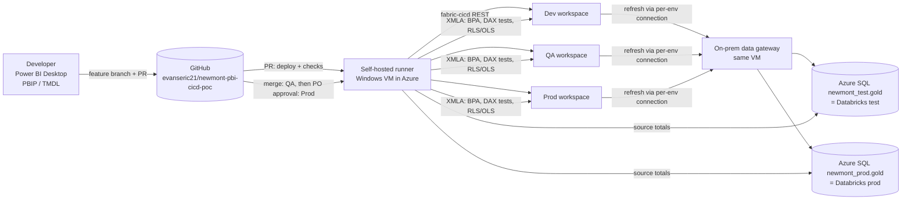
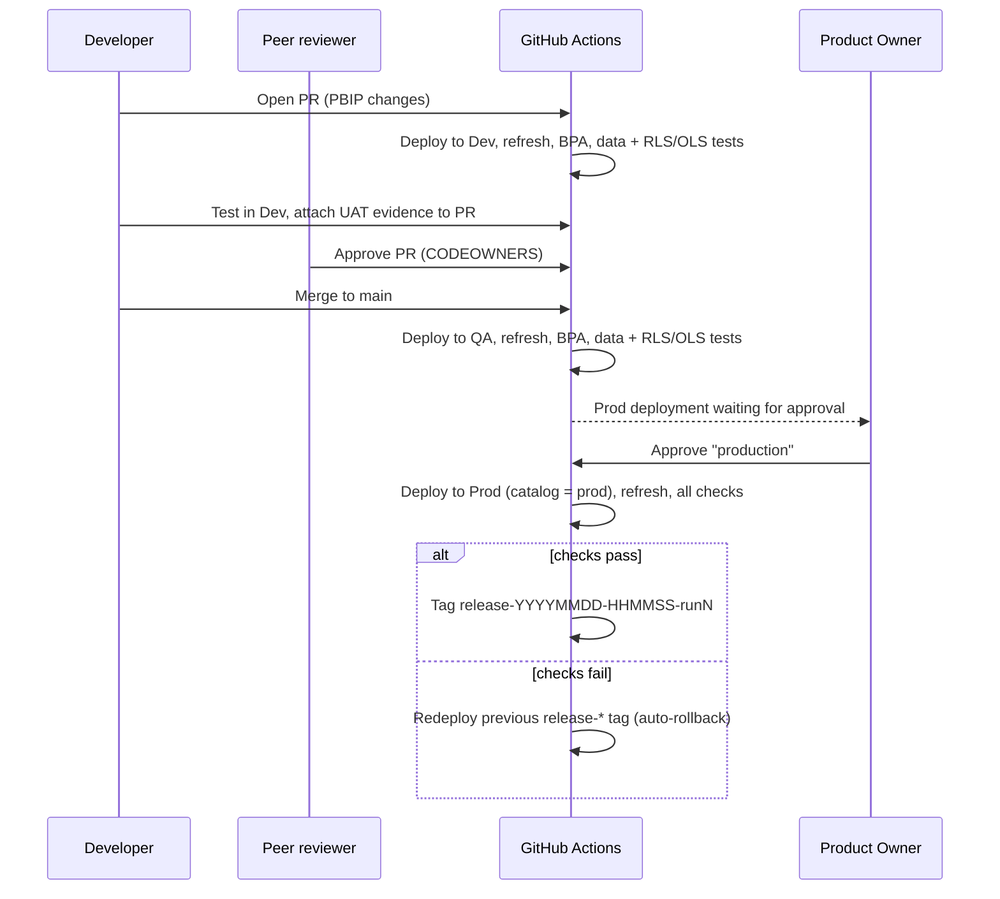

# Newmont Power BI CI/CD POC – Plan

## Goal
Demonstrate an end-to-end CI/CD flow for Power BI semantic models and reports, from Power BI Desktop to GitHub to the Dev, QA and Prod Fabric workspaces. The test environment mirrors Newmont's setup, so the team can see the full flow before anything touches Newmont workspaces.

## Scope (from the email to Newmont)
| Requirement | How the POC implements it |
|---|---|
| Separate Dev, QA and Prod workspaces | 3 Fabric workspaces on a Fabric capacity: `Newmont POC - Dev / QA / Prod` |
| Cloud-hosted GitHub | Repo `evanseric21/newmont-pbi-cicd-poc` + GitHub Actions |
| One shared gateway connection, catalog/schema parameters per environment | One on-premises data gateway (on the runner VM). Two Azure SQL databases simulate the Databricks catalogs: `newmont_test` (Dev/QA) and `newmont_prod` (Prod), each with schema `gold`. `CatalogName`/`SchemaName` model parameters are swapped per environment by `src/parameter.yml`. ⚠️ The gateway needs **one connection per database** (Azure SQL connections include the database name); the pipeline binds each environment to its own connection ID. With Databricks on one hostname + HTTP path this collapses to a single connection |
| Peer developer review | Branch protection on `main`: PR, 1 approval, CODEOWNERS, stale approvals dismissed, last push approved by someone else |
| Developer testing with UAT evidence attached | Each PR deploys to **Dev** automatically. The `UAT evidence` check blocks merge until the PR has a "UAT evidence" section with an attachment or link and the tested checkbox is ticked |
| Product Owner approval and deployment | `production` GitHub environment: PO as required reviewer, self-approval prevented. Approving the waiting job deploys to Prod |
| Promotion checks | Each environment runs: **model quality** (Tabular Editor BPA), **refresh** in the target workspace, **data validation** (row counts and key totals vs. source), **RLS/OLS verification** |
| Rollback | Each successful Prod deploy is tagged `release-*`. If Prod checks fail, the previous tag redeploys automatically, and there's a manual "Rollback Prod" workflow |

## Architecture

## Promotion flow

## Key design decisions
| Decision | Choice | Why |
|---|---|---|
| Deployment engine | GitHub Actions + `fabric-cicd` (Microsoft OSS Python library) | GitHub handles approvals, history and tags. Parameterization comes from `parameter.yml`. Newmont can reuse the same approach |
| Source format | PBIP with TMDL semantic model | Readable diffs, so peer review works. Desktop opens and saves it directly |
| Data source | Two Azure SQL databases, `newmont_test` / `newmont_prod` (schema `gold`) | Low-cost stand-in for Databricks `catalog.schema`: database = catalog. Mirrors test and prod being separate. Costs two connections on the one gateway, which is also what Newmont needs if test and prod are separate Databricks endpoints |
| Runner | Self-hosted Windows VM (also hosts the gateway) | Tabular Editor 2 and ADOMD.NET need Windows. The runner also needs network access to the data source for reconciliation, as Newmont's private Databricks will |
| Quality and security tests | Over the XMLA endpoint, using a service principal | XMLA is the only API that can run BPA, DAX as a specific role (`Roles=`), and OLS checks |
| Repo visibility | Public (POC only). Fork PRs are blocked from the runner | A personal GitHub Free account only gets required reviewers on public repos. Newmont would use a private or internal repo on GitHub Enterprise |

## Workstreams and tasks
| # | Workstream | Tasks | Owner |
|---|---|---|---|
| 1 | Tenant prerequisites | Fabric capacity or trial. Tenant settings: *Service principals can use Fabric APIs*, *Allow XMLA endpoints* (capacity: Read Write). Create the Entra app registration (SP) and a security group | Eric |
| 2 | Azure infrastructure | Deploy `infra/main.bicep` (SQL server, `newmont_test` and `newmont_prod` databases, VM), then run `sql/seed.sql` against each database | Eric |
| 3 | Gateway | Install the gateway on the VM, register the cluster, create one Azure SQL connection per database (test, prod), add the SP as a user on both | Eric |
| 4 | Workspaces | Create Dev, QA and Prod workspaces on the capacity. Add the SP as Admin | Eric |
| 5 | Runner | Run `scripts/Setup-RunnerVm.ps1` on the VM | Eric |
| 6 | GitHub governance | Run `scripts/Configure-GitHub.ps1` (environments, PO reviewer, secrets, branch protection, fork lockdown). Add `ericevans_microsoft` as collaborator (peer reviewer / PO) | Eric |
| 7 | Model and report | Open `src/NewmontProduction.pbip` in Desktop, connect to SQL, add 3–4 visuals, save | Eric |
| 8 | Dry runs | (a) Happy path PR → Dev → QA → Prod. (b) BPA failure blocks the PR. (c) A data validation failure blocks QA. (d) PO rejects the deployment. (e) Prod failure triggers auto-rollback. (f) Manual rollback | Eric |
| 9 | Demo and handover | Demo script, Q&A doc (`docs/Newmont-QA.md`), replication guide for Newmont | Eric |

## Demo script (≈30 min)
1. Show the PBIP/TMDL repo layout and `parameter.yml`, where the catalog switches per environment.
2. Desktop: add a measure, save, push a branch, open a PR.
3. PR checks: Dev deploy, refresh, BPA, data and RLS/OLS results in the job summary. Show `UAT evidence` failing until a screenshot is attached.
4. Peer approves and the PR merges. QA deploys automatically.
5. Prod waits for the PO. The PO approves. Prod deploys against `newmont_prod` (totals are 1.5× test, which proves the switch). It gets tagged.
6. Break something (for example, change an RLS filter so the test fails), merge, approve, and watch the auto-rollback to the last tag.
7. Run the manual "Rollback Prod" workflow.

## Risks and open items
See [Newmont-QA.md](Newmont-QA.md#open-questions-for-newmont) for the questions we need Newmont to answer and the known limitations.
